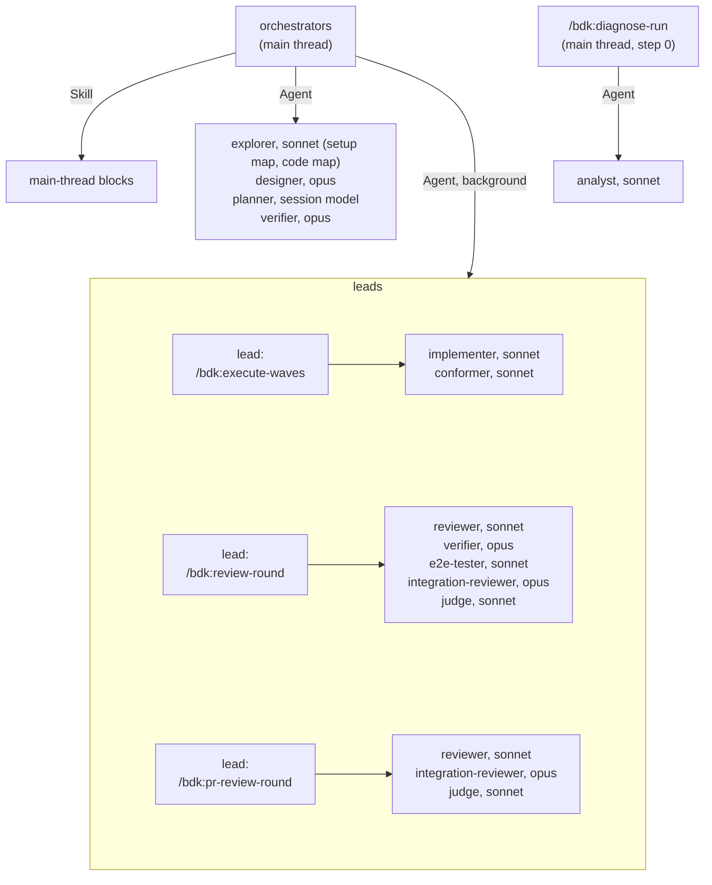

# Blocks and agents - who writes, who checks, who composes

One block, one job: an author block writes, a verifier block checks, an orchestrator or a lead composes. This page shows which agent runs which block and on which model.

Notation in the diagrams: see the [glossary](./glossary.md#notation-in-the-diagrams).

## Who starts whom

The main thread (an orchestrator, or a block a user typed) starts leads and single agents; a lead starts workers as foreground `Agent` calls. Every `Agent` call a BDK skill makes names its run mode: `run_in_background: false` for an agent the caller waits for, so the host never starts a worker in the background and a lead never waits on one by polling; only a lead started under `execution.lead: background` gets `run_in_background: true`. A block that runs in the main thread is called with the `Skill` tool.

The host nests subagents at most three levels under the main thread. BDK uses two: a lead (level 1) and its workers (level 2). Only `bdk:lead` starts agents; a worker runs its block itself and starts none, so the third level stays free.

`bdk:reviewer`, `bdk:integration-reviewer`, `bdk:judge` and `bdk:e2e-tester` have their skill preloaded through the `skills:` frontmatter; the other agents call the skill their prompt names with the `Skill` tool. A block with an agent of its own (`/bdk:explore-project`, `/bdk:recon`, `/bdk:explore`, `/bdk:design-draft`, `/bdk:verify-design`, `/bdk:plan-draft`, `/bdk:verify-plan`, `/bdk:implement-part`, `/bdk:conform-part`, `/bdk:repair-wave`, `/bdk:spec-conformance`, `/bdk:diagnose-run`) starts that agent when it runs in the main thread, instead of doing the work (its step 0), so the author never checks its own work. `/bdk:diagnose-run` has no orchestrator: you type it, and its step 0 starts `bdk:analyst`. `/bdk:review-group`, `/bdk:review-integration`, `/bdk:judge` and `/bdk:e2e-check` have no step 0: in a round the lead starts their agents, and typed by a user they run in the main thread, like the main-thread blocks of the table below. Why blocks reach their agents this way: [ADR-0023](../adr/0023-agent-block-starts-its-own-agent.md).

## Roles

| Block | Role | Runs on (default model) | Writes | Reads |
|---|---|---|---|---|
| `/bdk:explore-project` | author (project map) | `bdk:explorer` (sonnet) | `.bdk/runs/setup/project-map.md` | rules and hooks, manifests, scripts, test and CI configs |
| `/bdk:recon` | author (facts on AC) | `bdk:explorer` (sonnet) | `R/explore/propose-recon.md` | proposal, source, code |
| `/bdk:explore` | author (map) | `bdk:explorer` (sonnet) | `R/explore/design.md` | proposal, recon, code |
| `/bdk:design-draft` | author | `bdk:designer` (opus) | `C/specs/**/spec.md`, `C/design.md` | proposal, explore map, last `verify-N.md` |
| `/bdk:verify-design` | verifier | `bdk:verifier` (opus) | `R/design/verify-N.md` | proposal, specs, design, explore map, code |
| `/bdk:plan-draft` | author | `bdk:planner` (session's model) | `C/plan/parts/NN.md` | proposal, specs, design, code, last `verify-N.md` |
| `/bdk:verify-plan` | verifier | `bdk:verifier` (opus) | `R/plan/verify-N.md` | parts, specs, design, code |
| `/bdk:execute-waves` | lead | `bdk:lead` (sonnet) | `R/state.json`, `R/execute/result.md`, commits | parts, worker reports |
| `/bdk:implement-part` | author (code) | `bdk:implementer` (sonnet) | product code and tests, `R/execute/part-NN.md` | part, specs, design, rules, `CLAUDE.md` |
| `/bdk:conform-part` | verifier that fixes without changing behaviour | `bdk:conformer` (sonnet) | `R/execute/conform-NN.md`, behaviour-neutral edits | diff, rules, instructions, tasks |
| `/bdk:repair-wave` | author | `bdk:implementer` (sonnet) | the files of a wave's parts, `R/execute/wave-N.md` | red wave check, the wave's parts and diff |
| `/bdk:review-round` | lead | `bdk:lead` (sonnet) | `round-N/groups.json`, `round.md` | worker replies |
| `/bdk:review-group` | verifier | `bdk:reviewer` (sonnet) | finding events | group files, part, scenarios, review rules, project instructions |
| `/bdk:review-integration` | verifier | `bdk:integration-reviewer` (opus) | finding events | whole Change, group findings |
| `/bdk:e2e-check` | verifier | `bdk:e2e-tester` (sonnet) | `R/review/round-N/e2e/` (`R/e2e/` alone), finding events | the proposal, the running product |
| `/bdk:judge` | verifier | `bdk:judge` (sonnet) | level events, `round-N/review.md` | findings, code, scenarios, cited rules and instructions |
| `/bdk:triage` | decider | main thread | decision events, `review.md` refresh | judged findings |
| `/bdk:plan-fixes` | author | main thread | `round-N/fixes/parts/NN.md`, `fixes/index.md` | fix decisions, code |
| `/bdk:spec-conformance` | verifier | `bdk:verifier` (opus) | `R/close/spec-conformance.md`; in a review round (`--round`) `round-N/spec-conformance.md` and finding events | spec deltas, main specs, diff, E2E results (not in a round) |
| `/bdk:diagnose-run` | verifier (of a finished run) | `bdk:analyst` (sonnet) | `R/diagnostics.md` | run files, host transcripts through `bdk diagnostics report` |
| `/bdk:diagnose-bug` | author | main thread | fix Change, `R/debug/*.md` | bug report, product, code |
| `/bdk:commit` | tool | main thread | git commits | diff, commit convention |
| `/bdk:adr` | tool | main thread | one ADR file | design decision or text |

The model and effort of each agent can be overridden with `models.<role>.model` and `models.<role>.effort`, where the role is the agent's name (`lead`, `explorer`, `designer`, `planner`, `verifier`, `implementer`, `conformer`, `reviewer`, `integration-reviewer`, `e2e-tester`, `judge`, `analyst`); every stage that starts the agent passes them, so `models.verifier` sets the verifier of `/bdk:design`, `/bdk:plan`, every review round and `/bdk:close` alike. See [CLI, configuration and hooks](./cli-config-hooks.md#configuration-bdk-settings-yaml).

`/bdk:review-group`, `/bdk:review-integration`, `/bdk:judge`, `/bdk:triage` and `bdk:verifier` run each `bdk` call as a Bash command of its own, with every argument written out: no `cd`, `;`, `&&`, pipe or shell variable around or inside it. The permission rule `/bdk:setup` writes for `bdk` matches only that form; a compound call, or one with a variable in an argument, is refused or asks you. The review blocks under `--workdir` (a pull request reviewed in its own worktree) run `cd <worktree> && bdk ...`, which the skills grant. Why BDK fits its commands to narrow grants, never the grants to its commands: [ADR-0024](../adr/0024-commands-alone-under-narrow-grants.md).

## The tools `/bdk:commit` and `/bdk:adr`

Both run in the main thread without a BDK configuration, and both follow your project's convention before their own default.

- `/bdk:commit` writes the message in the first convention it finds: a commitlint configuration, the commit section of `CONTRIBUTING.md`, then the subjects of the last 20 commits; Conventional Commits otherwise. It adds no `Co-Authored-By`, tool or agent line unless that convention shows one. It commits exactly what is staged; with nothing staged, it stages by path the changes and the new files they use, never with `git add -A` or `git add .`, leaves out files that look like secrets or local artefacts (`.env*`, keys, logs, build output) and lists them, and splits unrelated changes into one commit each. It never passes `--no-verify`, never amends unless asked and never pushes; a hook that rejects for a reason other than the message stops it with the hook's output.
- `/bdk:adr` writes one record in your ADR directory and format (an `.adr-dir` file, `docs/adr/` and the other usual homes), MADR under `docs/adr/` when the project has none, numbered one above the highest. It takes a free-form decision or a decision `D<N>` of a Change's `design.md`, gives every option its pros and cons, and when the new record replaces an accepted one, changes only that record's status to superseded. It commits nothing.

## Compose your own

Every block runs alone, so a team can change the flow without changing BDK:

- **Your own orchestrator**: a project skill (`.claude/skills/<name>/SKILL.md`) that calls BDK blocks with the `Skill` tool or starts BDK agents with the `Agent` tool, in the order your team works. A block reads the same run files whoever calls it.
- **Your own rules**: rules declared under `rules` in the settings join the [rule pack](./rules.md), and `enabled: false` switches a pack rule off.
- **Settings**: commands, gates, budgets and models per [configuration layer](./cli-config-hooks.md#configuration-bdk-settings-yaml).
- **A subset of plugins**: each plugin of the marketplace installs and works alone ([install](../guide/install.md)).

## Sources

- `plugins/bdk/agents/*.md` (frontmatter `model`, `skills`, `tools`)
- `plugins/bdk/skills/*/SKILL.md` (step 0 of each block)
- `plugins/bdk/skills/{commit,adr}/SKILL.md`
