# Orchestrators - what each BDK command runs, in which order

Each orchestrator composes blocks and agents; the diagrams show the order, the parallel work, the loops, the budgets, the retries and the model escalation.

Notation in the diagrams: see the [glossary](./glossary.md#notation-in-the-diagrams).

Every orchestrator runs in the main thread, starts with a `!` block that runs `bdk config show`, and stops with "BDK not configured: run /bdk:setup" when there is no configuration. Each one writes only its own gate or result file; the blocks write everything else.

## `/bdk:setup`

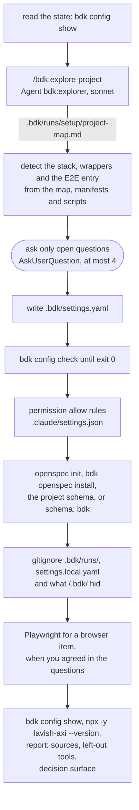

Setup runs on `opus` (its `model` frontmatter), whatever the session model; the map comes from `bdk:explorer`, which `models.explorer` sets. A re-run keeps every value a layer sets and fills only what is missing; an argument such as "add the e2e entry" limits the run to that change.

## `/bdk:propose`

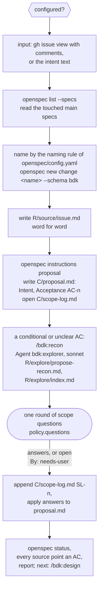

It never commits, branches or writes to GitHub. A Change of no behaviour sets `skip_specs: true` in `.openspec.yaml`; it still has Intent and Acceptance. An answer that changes an AC keeps its id, strikes the old text and names the entry (`(SL-1)`). Under `decide-and-record` a question that touches no AC takes its default; one that touches an AC stays open as `By: needs-user` and changes nothing in the proposal.

## `/bdk:design`

Three blocks and a gate. The verifier is one agent continued with `SendMessage` across passes, so it keeps the context of what it checked.

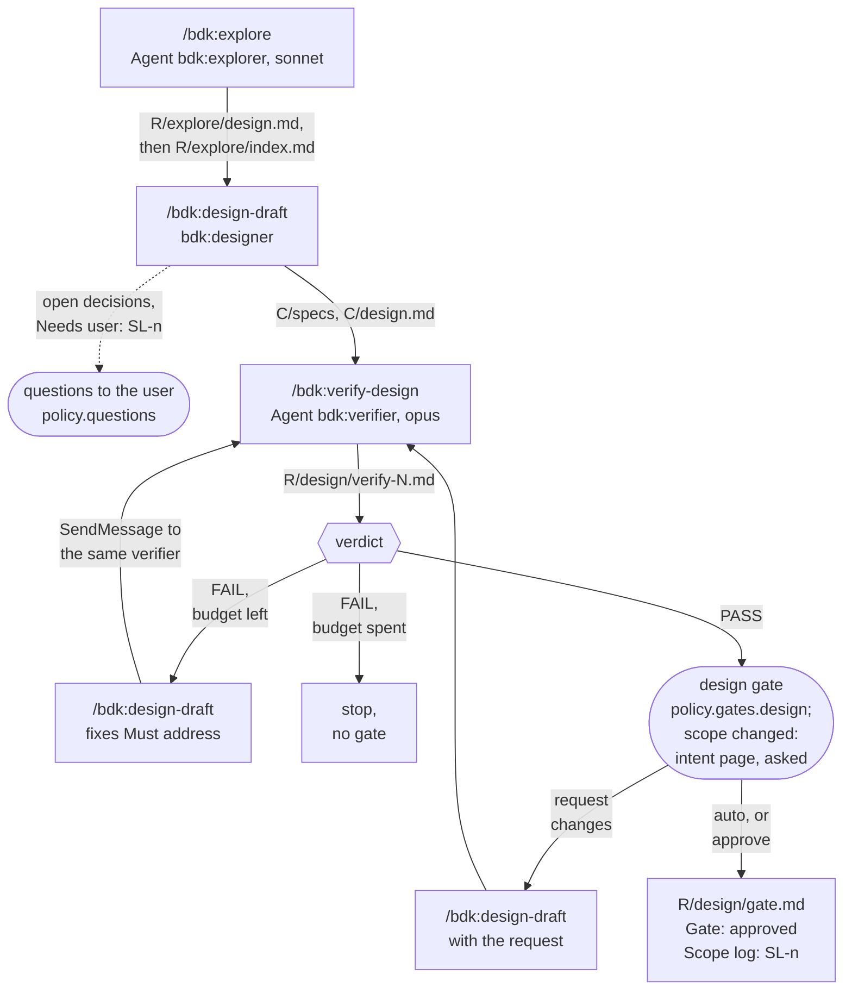

Every block runs in the foreground: `/bdk:design` waits for each one before the next step.

Questions come in rounds, at most three. The designer writes the round's Lavish page, opens it and hands back; `/bdk:design` waits on the page (`lavish-axi poll`) and passes your answers to the same designer. A note on the page that asks for something new opens a decision for the next round; an answered decision is never asked again. When you stop the wait (for a summary, say), the answers you give on the page stay queued, and `/bdk:design <change>` picks them up. Without Lavish the questions come through `AskUserQuestion`, or in the reply.

Every question on the page is a card you can decide from without opening the proposal or the code: **Context** says what the proposal says and what the code does today, with `file:line`; **Options with consequences** gives each option's cost, risk, what it leaves uncovered and what it breaks; **Recommendation** names the option the designer would take and why. The designer checks each card before the page opens, also a page it opens again on resume, and fixes a card that lacks one of them. The page is in the language you write in: `/bdk:design` tells the designer; its look follows Lavish's own design guidance.

The designer reads the proposal's `## Acceptance`, the source `R/source/issue.md`, `C/scope-log.md` and `R/explore/index.md`, and answers every AC in the spec deltas and `design.md`. An answer of yours that changes an AC is a new scope-log entry (`Stage: design`, `By: user`), and the AC in `proposal.md` is struck and rewritten naming it. Under `decide-and-record` the designer never changes an AC: it appends an open entry `By: needs-user` and ends with `Needs user: SL-n`, and `/bdk:design` stops there; the next `/bdk:design <change>` in a session that can ask puts that entry first.

When the log holds a change after propose that no earlier gate approved, the gate shows it on the intent page `R/design/intent.html`, under `manual` and `auto` alike: the intent with every changed word struck, one card per change with why and the options, a table of every AC before and after, and the flow before and after. The designer writes it in intent page mode; its `bdk-scope-log` meta names the last entry it shows, so a stale page is written again.

An answer that adds or drops a capability changes `proposal.md` too: the designer owns that edit and records it in `design.md` as `Scope changed by the user:`. An answer against the issue's acceptance signal or a project rule (`CLAUDE.md`, `.claude/rules/`, the rules of `openspec/config.yaml`) is asked once more, quoting the rule; when you keep it, `design.md` records a `Deviation:` line, which the gate and the report name so you update the issue. BDK does not edit the issue.

The manual gate, and any gate with a scope change to show, ends on exactly one question: approve, or say what to change. `gate.md` records `Scope log: SL-n`, the last entry approved with the design.

The verifier budget is `policy.budgets.verifier` (default 3) passes per run. On a new start, `/bdk:design` skips every step whose file exists:

| Files found | Starts at |
|---|---|
| `gate.md` approved for the last report | nothing: reports the approved design |
| no `explore/design.md`, no `design.md` | explore |
| no `design.md` | `/bdk:design-draft` |
| no `verify-N.md` | `/bdk:verify-design` |
| last `verify-N.md` is `FAIL` | `/bdk:design-draft` fix, then `/bdk:verify-design` |
| last `verify-N.md` is `PASS` | the gate |

## `/bdk:plan`

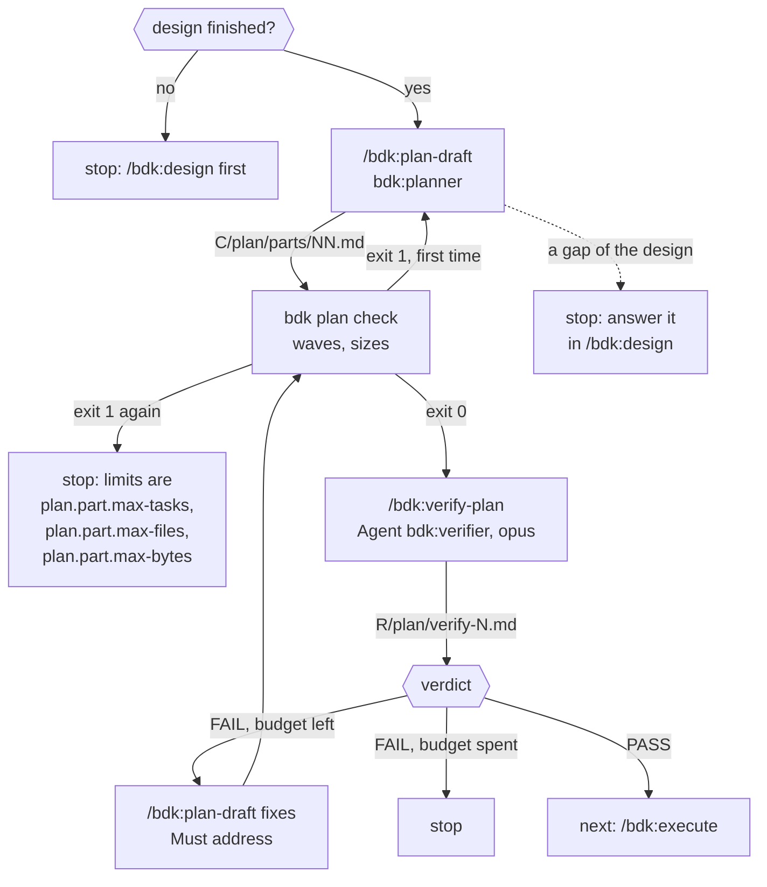

"Design finished" means `proposal.md`, at least one spec delta and `design.md` exist, and the last `design/verify-N.md`, when there is one, passes. A later pass continues the same verifier with `SendMessage`. The verifier runs each `bdk` call as a Bash command of its own, so your permission rule for `bdk` covers it; when a call it needs is still denied, it writes no report, and `/bdk:plan` stops and shows the denied command instead of a verdict. On a new start, `/bdk:plan` starts at the draft (no part), the check (parts, no report), the fix (last report `FAIL`) or the report (last report `PASS`).

A gap of the design is a choice about what the product does that the specs and the design leave open: a case a new requirement reaches counts even when no scenario names it, when its answers differ in a way you would care about, such as whether `--out <path>` overwrites a file that already exists. Ordinary input handling that the Change's error rules settle by analogy is the planner's choice, not a gap. `/bdk:plan-draft` names each gap in its reply and decides none; `/bdk:plan` then stops before any verifier pass, quotes the gaps and names `/bdk:design <change>`. Behaviour no requirement of the Change touches is not a gap and stays as the code has it.

## `/bdk:execute` and the `/bdk:execute-waves` lead

`/bdk:execute` is thin: it starts one `bdk:lead` with the stage skill `/bdk:execute-waves` and passes the result on. The lead is the only writer of `state.json` and the only agent that commits. It builds every part in your checkout, on the Change branch, one at a time: no part runs in a git worktree, and nothing is merged ([ADR-0019](../adr/0019-parts-run-one-at-a-time-in-the-main-checkout.md)).

The stage builds every part of the plan and takes no part id: called with one (`/bdk:execute add-csv-export 01`) or asked for one part, it starts no lead and names [`/bdk:implement-part`](/reference/bdk/skills#implement-part) `<change> <part-id>`, the block that builds one part, uncommitted.

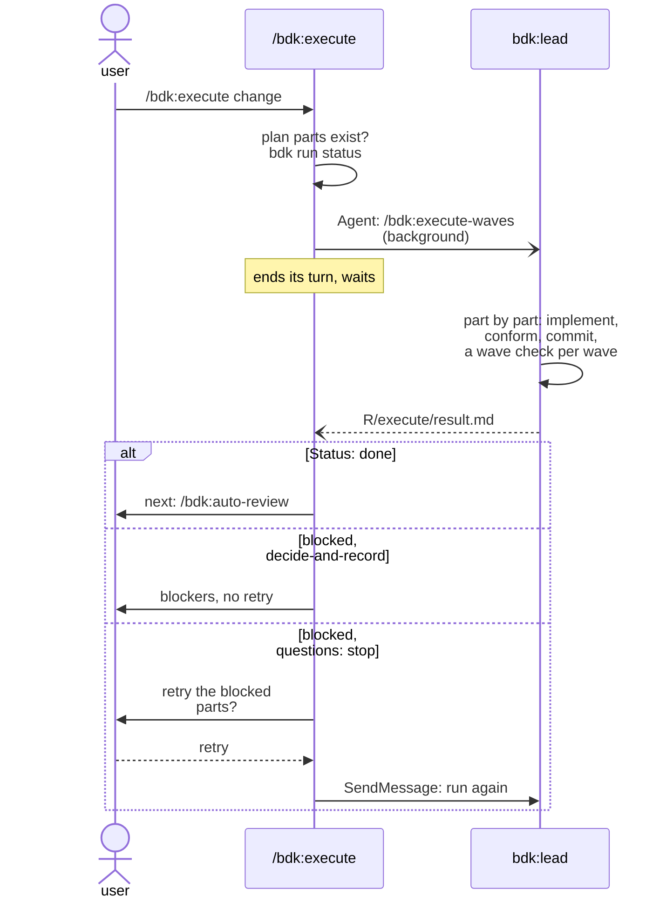

Inside the lead, waves run in order and the parts of a wave one after another, in ascending id, each committed before the next starts:

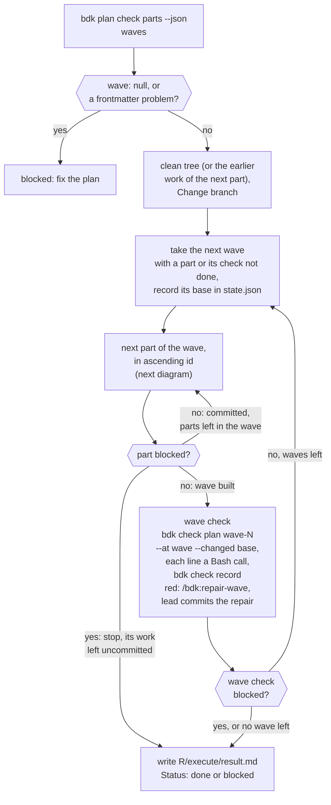

Every part runs where your project is installed: its dependencies, env files, database and ports, and warm tool caches. Each part starts from the commits of the parts before it, so two parts of one wave may change the same file. A blocked part stops the stage at once, before any later part: the next part's `git add -A` would otherwise commit the blocked part's unfinished work. Its files stay uncommitted in your checkout; the next `/bdk:execute` continues the part from them, and stops only on changes outside that part's `files`.

Each part goes through these attempts. The checks each worker runs are in the boxes; [Where execute runs your checks](#where-execute-runs-your-checks) has the details:

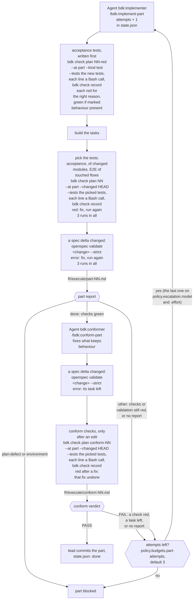

One part, step by step inside its two worker agents:

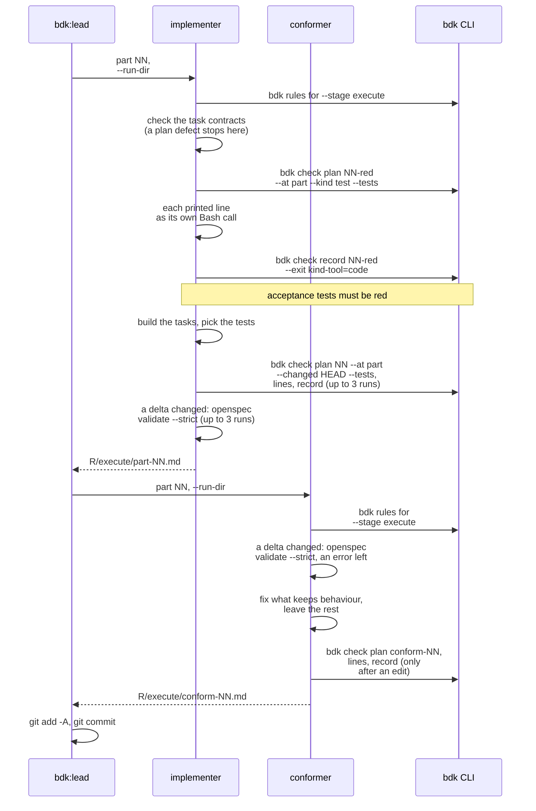

### Where execute runs your checks

Every check of the execute stage runs your `tools.test`, `tools.lint` and `tools.build` commands (the [`tools`](/reference/bdk/settings#tools) items) in three steps. `bdk check plan` picks the items and prints, for each, the line to run: your command as configured, stdin closed, its whole output into a file under `R/checks/<id>/` (`npm run test:e2e -- e2e/checkout.spec.ts </dev/null > .bdk/runs/<change>/checks/02/test-playwright.txt 2>&1`), with the Bash timeout of the call. The agent that needs the check runs each line as its own Bash call, so its transcript shows your real command, how long it ran and its exit code. Then `bdk check record` takes each exit code and writes the result `R/checks/<id>.json` and prints the last lines of each red check. No agent runs a test, linter or build command other than a printed line. Each check names its check point with `--at`, and runs only the items whose `when` holds that point, plus the items without `when` ([check points](/guide/configuration#a-web-app-with-a-browser-e2e-check)). Four checks, in this order:

| Run | Who, when | Point, files | When it is red |
|---|---|---|---|
| `NN-red` test only | `bdk:implementer`, [`/bdk:implement-part`](/reference/bdk/skills#implement-part) step 4, before any code | `part`, the new acceptance tests (`--tests`) | expected: each test must fail because the behaviour is missing, its own failure seen, in the output file when the last 20 lines printed under the red check do not show it; a broken test is fixed and run again. No `tools.test` item at `part` for these files blocks the part (`environment`) |
| `NN` | `bdk:implementer`, step 6, once the tasks are built | `part`: test items the tests it picked (the acceptance tests, the existing tests of the modules it changed, the E2E specs of the flows it touched); lint and build items the files changed against `HEAD` | fix and run again, three runs in all; still red, the run ends as a blocker (`other`) and the lead retries the part. No `Status: done` without a green run |
| `conform-NN` | `bdk:conformer`, [`/bdk:conform-part`](/reference/bdk/skills#conform-part) step 5, only when it edited a file | `part`: test items the implementer's picked tests plus those of the modules it edited; lint and build items the files changed against `HEAD` | a fix that broke it is undone; still red, the verdict is `FAIL` and the lead retries the part. With no edit it runs nothing and names `NN` unchanged |
| `wave-N` | `bdk:lead`, [`/bdk:execute-waves`](/reference/bdk/skills#execute-waves) step 6, once every part of the wave is committed on the Change branch | `wave`, the files changed since the wave's base, test items too (no picked tests: the wave runs whole suites) | `bdk:implementer` with [`/bdk:repair-wave`](/reference/bdk/skills#repair-wave) repairs what two parts broke together and the lead commits it; still red, one more repair on `policy.escalation.model`, then the wave is blocked and no later wave starts |

**A part that changes a spec delta.** OpenSpec refuses a delta it cannot parse, such as a requirement without a scenario, and `/bdk:close` cannot archive it. So when a part's diff changes a file under `openspec/changes/<change>/specs/` (a review fix part may), the implementer runs `openspec validate <change> --strict` after its part checks and fixes what it reports, three runs in all, and the conformer runs it again whatever the implementer reports: an error on a delta of the part is left under its task, so the verdict is `FAIL` and the lead retries the part. Both reports name the run under `## Checks`. It is the one command besides the printed check lines the execute workers run; without an `openspec` command they write `not run` and go on, and the review round and close read the delta later.

**Which files a check covers.** `--changed <ref>` hands the check the files git reports changed against `<ref>`, untracked ones included. `--tests <path>` hands test items the tests the agent picked instead, so what runs follows what the part should prove, not only what it changed: a change to `src/checkout.ts` runs `e2e/checkout.spec.ts` when the implementer picks it, and a part that picks no E2E spec runs no E2E suite. An item whose `command` holds `{files}` gets the files its `paths` match, and is skipped when none matches; an item with `paths` and no `{files}` runs its whole command only when one of its files changed; any other item runs its whole command ([configuration](/guide/configuration#examples)). A part's checks cover the files it changed against `HEAD`, the commit of the part before it; the wave check is the first run on all the parts of a wave together.

**Long commands.** The Bash tool ends a call after 600 seconds unless `BASH_MAX_TIMEOUT_MS` raises its cap. An item with a longer `timeout` gets a note in the plan naming the value to set, and `/bdk:setup` sets `env.BASH_MAX_TIMEOUT_MS` in `.claude/settings.json` for it ([configuration](/guide/configuration#long-checks)).

**Where a slow suite runs.** Keep the fast checks of the changed files at `part`, the main test suite and the type check at `wave`, and the slow suites, a whole Playwright suite and the build at `review`: the first round of [`/bdk:auto-review`](#bdk-auto-review) runs them (`bdk check plan round-N --at review`, the lines, `bdk check record --round N`), where a red check is a `blocker` finding. A Change you take from `/bdk:execute` straight to a pull request has passed its part and wave checks only.

## `/bdk:auto-review`

Rounds and fix passes each run in a fresh `bdk:lead`; triage and fix planning run in the main thread. Round 1 reviews the whole Change, a later round only the fix commits of the round before. The review fixes nothing in place: each finding decided `fix` becomes a task of a fix part that the execute lead builds test-first, and every fix pass is reviewed by the next round ([ADR-0013](../adr/0013-review-fixes-as-fix-parts.md)).

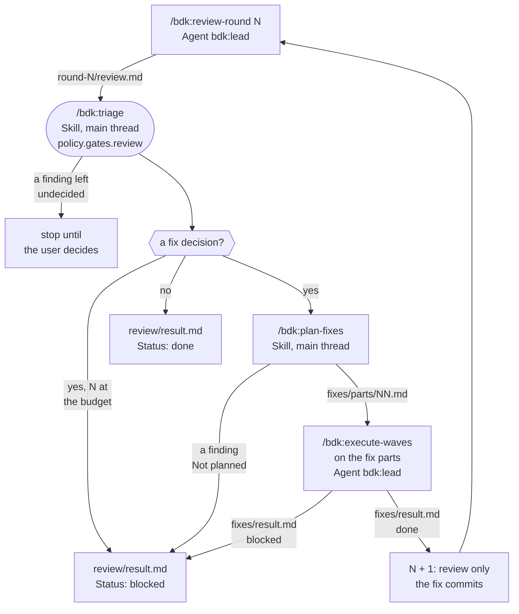

The budget is `policy.budgets.review-rounds` (default 3); at the last round triage runs with `--last-round`.

The status of `review/result.md` comes from the round files only: `/bdk:auto-review` takes no defect from a worker's reply or from code it read, so a defect counts once a reviewer logs it, and one no log holds neither blocks the stage nor appears in the result or the reply.

On a new start, `/bdk:auto-review` finds its place from the files of the last round: no round or a round without `review.md` runs the round, an undecided finding runs triage, a round without `fixes/index.md` plans the fixes, and an unfinished `fixes/result.md` runs the fix pass again.

Triage policy, which decides in auto mode and is the preselected recommendation in manual mode:

| Level (set by the judge) | Decision | With `--last-round` |
|---|---|---|
| `blocker` | `fix` | `fix` |
| `should-fix` | `fix` | `defer` |
| `nice-to-have` | `defer` | `defer` |
| `not-a-problem` | `accept` | `accept` |

## `/bdk:review-round` (lead skill)

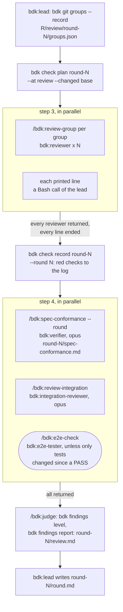

`bdk git groups` gets `--rounds R/review`, so a later round covers only what changed since the round before ([ADR-0014](../adr/0014-later-rounds-review-the-fix-scope-and-re-run-every-check.md)), and `--plan` with the plan parts (round 1) or the fix parts of the round before, so each group is one part. Every finding lands in `round-N/findings.jsonl`. Each step starts its agents in one message, in batches of `execution.max-parallel` when they number more. The verifier runs the check `/bdk:close` runs before the archive (`/bdk:spec-conformance`, see below) in every round ([ADR-0015](../adr/0015-spec-conformance-every-round-and-at-close.md)), so a spec delta that misses an error message, or a requirement the code breaks for an input its scenario does not use, becomes a `blocker` finding the fix pass fixes, instead of a stop at close; it reads no E2E results, because the E2E tester logs its own failures. The verifier, the integration reviewer and the E2E tester start together once the group reviewers have returned and the check run is recorded, so your suites and the started product never compete for the same ports or browsers. None of the three reads another's output: the integration reviewer reads the group findings, not the verifier's findings nor the E2E verdict, so it never waits for the slower verifier (about two minutes on opus), and a problem two of them log is a repeat the judge levels `not-a-problem`. A later round whose fix commits changed only test files (`testsOnly` in `groups.json`, from file names such as `test/`, `__tests__/`, `*.test.*` or `*_test.*`) runs no E2E check when the last E2E verdict passed or was skipped: the product is the one that verdict checked, so the round writes no `round-N/e2e/` and its `round.md` names the verdict it carries over. A fix that touches any other file, or a last verdict `FAIL` or `BLOCKED`, gets the full check. A worker that fails is started once more with the same prompt; a second failure goes under `Gaps` in `round.md`.

## `/bdk:close`

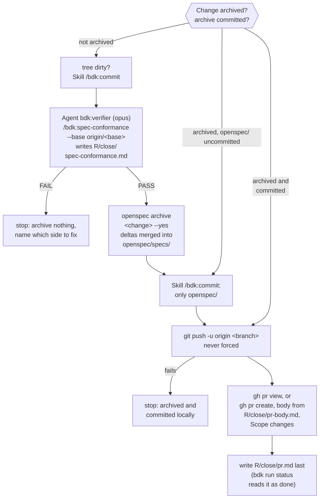

Close checks a Change that is not yet archived again even when an earlier report passed, since the code may have changed since; the verifier carries the earlier report's ids over. On any verdict but `PASS` it stops before the archive, names the report and the side to fix (the code or the Change's spec deltas), and fixes nothing itself: no code, spec delta or main spec is edited to make the check pass ([ADR-0015](../adr/0015-spec-conformance-every-round-and-at-close.md)). Fix that side, then run `/bdk:close <change>` again.

The pull request body says what the Change does, `Resolves #n` when the issue is known, the capabilities whose main specs changed, the spec conformance verdict, the E2E verdict (with every failed path the review cleared, its path file and finding id, when the verdict is `FAIL`), the number of review rounds, every decision taken without the user by its source, and a `Deferred` part with each deferred finding.

The body's `Scope changes` part copies every entry of the archived Change's `scope-log.md` in order (id, stage, AC, before, after, why, `By:`), so the reviewer checks the scope against your decisions; `none` without an entry.

## `/bdk:pr-review` and the `/bdk:pr-review-round` lead

Reviews any open pull request in a detached worktree; your own checkout is never touched. It runs no checks and no E2E: the pull request's CI runs the checks, and a teammate's code is not started on your machine. Nothing reaches GitHub before the user confirms.

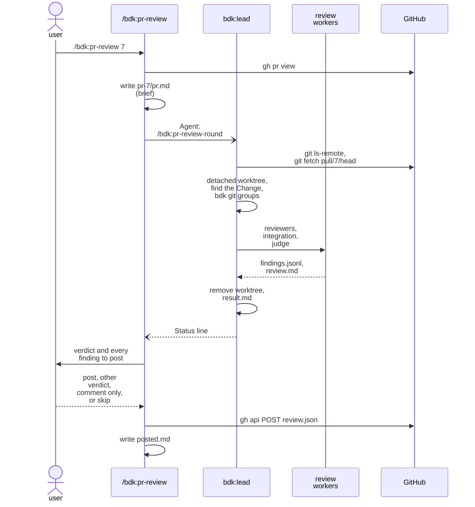

The workers get `--workdir`, `--change` (or `none`) and `--intent pr.md`. The question is skipped under `policy.questions: decide-and-record` or when the request says to post without asking; on your own pull request the review is posted as `COMMENT`.

Several pull requests (`/bdk:pr-review 7 8`) start one lead each in one message, at most `execution.max-parallel`; the reviews are shown when every lead has returned, and one question covers all of them. A lead checks the head with `git ls-remote` and fetches without `FETCH_HEAD`, so leads in one repository do not read each other's head.

`--verify` re-checks your previous review and reviews only the commits added since it. It reads that review from GitHub, from the hidden markers of your own posted review and threads, never from local run files ([ADR-0017](../adr/0017-pr-review-record-lives-on-github.md)):

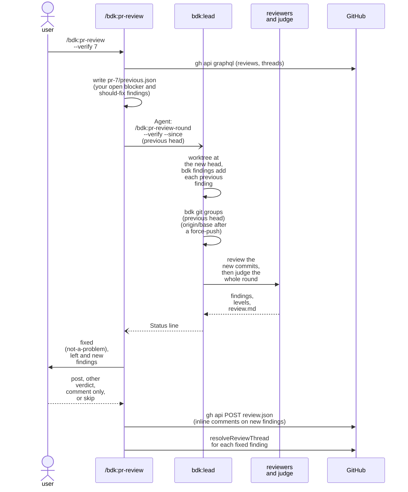

The previous findings go into the round's log before any reviewer starts, and the reviewers, the integration reviewer and the judge then run on the range from the previous review's head to the new head; after a force-push (the previous head is no longer an ancestor) they review the whole pull request. The judge levels the previous and the new findings together, and of two findings that repeat each other it keeps the earlier one. A previous finding the judge now levels `not-a-problem` is fixed; any other level is left. New `blocker` and `should-fix` findings inside the diff become inline comments, as in a review. A left or new `blocker` requests changes. Only threads you opened are resolved, and only after the review is posted.

## `/bdk:debug`

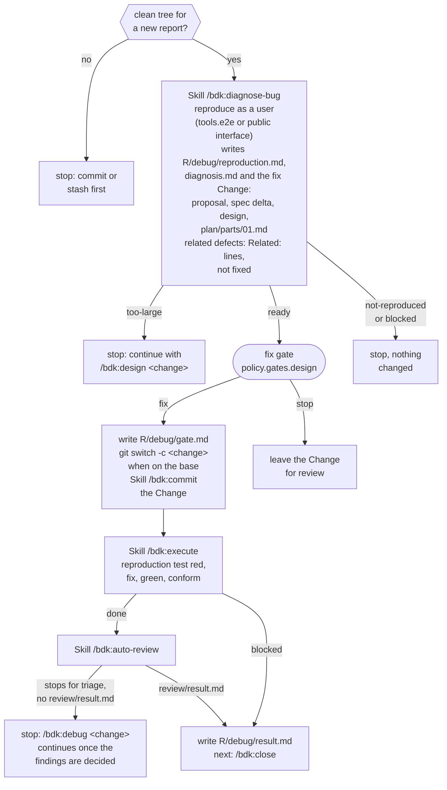

A bug that does not reproduce gets no Change; every reproduced bug, also a one-line fix, gets a one-part fix Change built, reviewed and closed by the normal stages ([ADR-0016](../adr/0016-bug-fix-is-a-reproduced-one-part-change.md)). The fix Change covers the reproduced bug only: its part has one acceptance scenario, the reproduction, whose test the implementer must see red. A related defect `/bdk:diagnose-bug` finds on the way, such as another bug or data the bug already wrote that fixing the cause does not repair, is named and not fixed: a `Related:` line in `diagnosis.md`, a "Related, not fixed" entry under Risks in the Change's `design.md`, the fix gate's question, and a `Related (not fixed)` line under `## Bug` in `debug/result.md`. Give each its own Change: `/bdk:debug` with its symptom, or `/bdk:propose`.

## `/bdk:diagnose-run`

A block you type after a run, not a stage: it reads how a run went and writes a report, and changes nothing else. The transcripts it reads are large, so its step 0 hands the work to one `bdk:analyst` and waits for it.

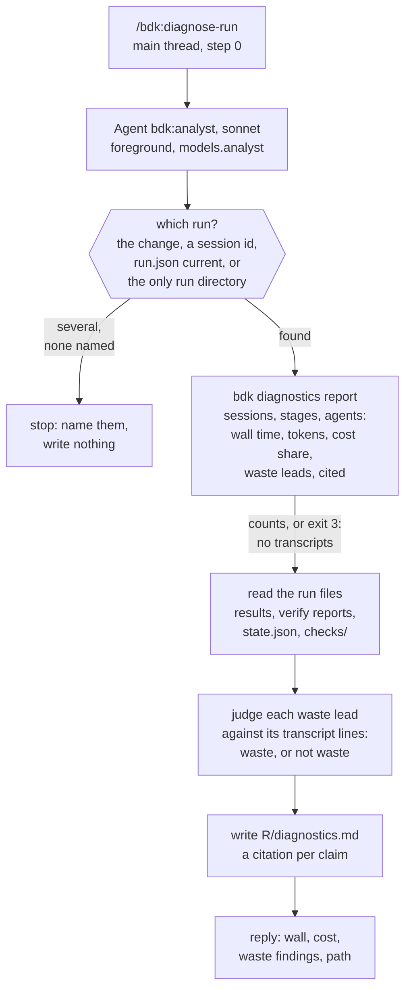

Every number in the report comes from `bdk diagnostics report`; the analyst never counts transcripts itself, and a cost it cannot cite is written as `unknown`. Without transcripts (exit 3) the report is written from the run files alone and says under `## Missing data` where the command looked. A session that names no Change gets `.bdk/runs/diagnostics/<session-id>.md`. Run it again at any time: the report is replaced.

## Sources

- `plugins/bdk/skills/{setup,propose,design,plan,execute,execute-waves,implement-part,conform-part,repair-wave,auto-review,review-round,triage,plan-fixes,close,pr-review,pr-review-round,debug,diagnose-bug,diagnose-run}/SKILL.md`
- `plugins/bdk/agents/*.md`
