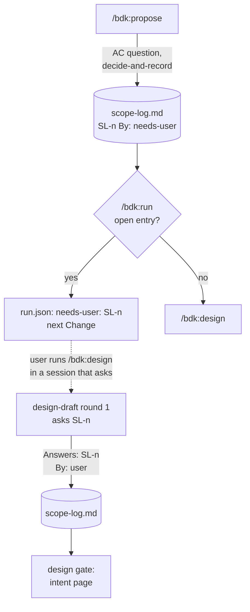

## Context

Today `/bdk:propose` (`plugins/bdk/skills/propose/SKILL.md`) reads the issue once (`gh issue view --json number,title,body,labels,state,url`, step 2), keeps no copy, and writes a proposal of Why, What Changes, Capabilities, Out of scope and Impact (step 6). An acceptance point lives only inside those prose sections, and with `skip_specs: true` it has nowhere to go. Each later verifier checks the stage before it: `verify-design` reads `proposal.md`, the deltas and `design.md` and says "Not a problem: ... anything outside the proposal" (`skills/verify-design/SKILL.md`, step 4), `verify-plan` checks parts against deltas and design, `review-integration` and `spec-conformance` check scenarios. A scope narrowing by the designer is recorded as `Decided without the user:` or `Scope changed by the user:` in `design.md` (`skills/design-draft/SKILL.md`, "Scope changes and deviations"), and the design gate only lists those lines (`skills/design/SKILL.md`, step 5).

The design session of 2026-10-15 (`.bdk/analysis/propose-shift-left/REPORT.md`, section 9) decided D1-D7: propose gets AC, a narrow recon and one decision round (D1); an AC change in an unattended run marks the Change "needs user" and the queue goes on (D2); `## Intent`, `## Acceptance` and an appended `scope-log.md` are committed markdown, HTML is only a view (D3); recon covers only conditional AC, reuse stays in the design explore (D4); the explorer is on sonnet (D5, done in #410); `.bdk/runs/<change>/explore/` holds several explorers' files and an `index.md` built from their front matter (D6); the "intent against now" page is HTML the model writes, shown once at one acceptance gate and only when intent or AC changed (D7). This design carries them out; they are not reopened.

Facts the design relies on:

- `run.json` keys outside the schema are ignored (`openspec/specs/bdk-cli/run/spec.md`, "run.json schema": "Unknown keys SHALL be ignored"; `plugins/bdk/src/run/store/status.ts:20-23` parses `version`, `mode`, `queue`, `current` only), so a queue entry can carry `"needs-user"` without a CLI change.
- `bdk run status` does not read the code map (`grep explore plugins/bdk/src` finds only the `explorer` model role, `src/config/domain/settings.ts:99`), so moving the map changes no CLI code.
- The offline `gh` stand-in prints `null` for a `--json` field its issue file lacks (`plugins/bdk/evals/fixtures/bin/gh`, `print`), so asking for `comments` works in eval runs; a case adds `comments` to its issue file.
- The `bdk:explorer` agent already runs `sonnet` and reads only (`plugins/bdk/agents/explorer.md`).

## Goals / Non-Goals

**Goals:** the AC of the source survive every stage; every verifier checks them against the source; every change of scope is a log entry that names who decided; an AC change is never taken without the user; the user sees each scope change once, on one page, at the design gate.

**Non-Goals:** a `bdk` helper for the log or the index (none until a measurement asks for one); targeted explorers beyond recon and the design map; changing the designer's or planner's model (the next issue, D5); editing the GitHub issue.

## Decisions

### D1. Propose saves the source, then writes AC before it asks

New order of `/bdk:propose`: configuration, input, main specs, open the Change, save the source, write the proposal with `## Intent` and `## Acceptance` as the source says, recon, one decision round, apply the answers, report.

- The source file `.bdk/runs/<change>/source/issue.md` holds, word for word, the issue's title, URL, state, labels, body and every comment (`gh issue view <ref> --json number,title,body,labels,state,url,comments`), then each issue the body names as the source of its scope (a parent, or an issue it continues or splits), each read the same way under its own heading. From an intent it holds the intent as the user wrote it. Propose writes it once and nothing changes it.
- `## Intent` quotes the issue's goal (or the intent) word for word, as a Markdown quote. `## Acceptance` lists `AC-1`..`AC-n`, one per acceptance point of the source (the acceptance signal and every point of the scope a user can check); a conditional point keeps its condition in its own words (`AC-3 (if the seed helper can set an expiry): ...`). Ids never change; a dropped AC stays listed, struck, with the log entry that dropped it.
- The proposal is written before recon and questions, from the source alone, because recon takes AC ids as input and the log's `Before:` text is the AC as the source gave it.

Alternatives: keep the issue only in the model's context (lost: nothing later can check against it, the OCR-376 root cause); copy the source into the committed Change (lost: D3 commits only the markdown the stages read as contract, the source is a run file; a lost checkout keeps `## Intent` and `## Acceptance`); ask before writing the proposal (lost: recon needs stable AC ids to report on).

### D2. scope-log.md: one entry per change, append only

`openspec/changes/<change>/scope-log.md`, committed with the Change. Propose creates it with a heading and a one-line rule; every later writer only appends.

```markdown
# Scope log: add-guest-links

Append only. An AC changes only through an entry `By: user`.

## SL-1
- Stage: propose
- Date: 2026-10-15
- AC: AC-3
- Before: AC-3 (if the seed helper can set an expiry): an expired link shows the expiry page.
- After: dropped
- Why: `seedGuest` takes no `expiresAt` (test/world.ts:41), so the condition does not hold.
- Options: drop AC-3 (default); add an `expiresAt` argument to `seedGuest` and keep AC-3
- By: user
```

Fields: `Stage` (`propose`, `design`; a later stage never writes, see D6), `Date`, `AC` (the ids it touches, or `Intent`, or `none` for a What Changes item), `Before` and `After` (quotes; `After: dropped`, or `After: added` style for a new AC under `AC: AC-5 (new)`), `Why` (with `file:line` when code settled it), `Options` (the default first), `By`. `By` is one of:

- `user`: the user chose it, in a question round or on a page.
- `setting <key>`: a setting chose it (`setting policy.questions decide-and-record`). Allowed only for an entry with `AC: none`.
- `needs-user`: open. The question waits for the user; `After` is the default, not applied.

A later entry `Answers: SL-n` (with its own `By: user`) settles an open one. An entry is open while it says `By: needs-user` and no later entry answers it. Verifiers tell the user from a setting by the `By:` line alone: a changed AC is covered only by an entry `By: user` whose `AC:` names it, directly or as the answer to an open one.

Alternatives: JSONL through a `bdk` command (lost: no measured need, and the file is read by people at review and committed); decisions inside `design.md` lines as today (lost: the stage that wrote them is the only one that reads them, and propose has no `design.md`); `## Decided without the user` in the proposal for AC too (lost: D2 of the session, an AC is never the agent's decision).

`## Decided without the user` of `proposal.md` stays for what a setting decided that touches no AC; such a decision also gets its `By: setting` log entry, so the log is the full history and the section stays what `/bdk:close` reads today.

### D3. Recon is its own block on `bdk:explorer`

A new skill `/bdk:recon` (`skills/recon/`), started by propose only when an AC is conditional or unclear: `subagent_type: "bdk:explorer"`, prompt `Run the skill bdk:recon with the arguments: <change> AC-2 AC-3`, the `models.explorer` model and effort when set. It reads `source/issue.md` and those AC of `proposal.md`, answers per AC only factual questions (does the condition hold in the code, does a named symbol or file exist, how many copies of a thing exist), and writes `.bdk/runs/<change>/explore/propose-recon.md` with the front matter of D4 and one section per AC: the facts, each with `file:line` or the help command, and `Settles:` saying whether the condition holds, does not hold, or stays open. No recommendation, no approach, no reuse candidates (D4 of the session).

Alternatives: propose reads the code itself (lost: the issue asks for one sonnet block, the main thread stays fast, and a reader of its own question is not neutral); a mode of `/bdk:explore` (lost: one block, one job; the map answers "what does the Change touch", recon answers "does this condition hold"); haiku (lost: #410 measured interpretation errors).

### D4. explore/ with front matter, index built by the orchestrator

```text
.bdk/runs/<change>/explore/
  index.md            built by the orchestrator that ran the block, never by hand
  propose-recon.md    /bdk:recon (only writer)
  design.md           /bdk:explore (only writer; was design/explore.md)
```

Each file starts with YAML front matter:

```yaml
---
question: Do the conditional AC hold in the code?
summary: AC-3 does not hold - seedGuest takes no expiresAt.
stage: propose
files: [test/world.ts, src/links.ts]
---
```

After a block writes its file, the orchestrator (`/bdk:propose` after recon, `/bdk:design` after explore) reads the front matter of every file in `explore/` other than `index.md` and writes `index.md` again: one line per file, `- [<file>](<file>) (<stage>) <question> - <summary>`. It rewrites the whole file from the front matter, so it never drifts and needs no merge. Readers (`design-draft`, `verify-design`) read `index.md` first, then only the files whose question they need; a missing index means reading the files directly.

The map moves to `explore/design.md`; `/bdk:explore` keeps its sections and gains the front matter; follow-ups append to it as today. Up to about 12 targeted files fit the layout; no block writes one yet.

Alternatives: a `bdk explore index` helper (lost: no measured need, the index is a few lines, the issue says start with the lead); each block appends its own line to the index (lost: a file with many writers, and a rewritten block leaves a stale line); keep `design/explore.md` and add `propose/recon.md` (lost: D6 of the session, one directory per kind so readers start from one index).

### D5. One decision round in propose, AC decisions only for the user

Open scope questions of propose: two readings of the source that change behaviour, a closed issue, a condition recon left open or found false, an AC recon shows cannot be met as written, and any AC the agent would drop, narrow or reinterpret. All of them go into one round, each with options and the default first.

- `policy.questions: stop` with `AskUserQuestion`: one call, all questions (at most four per call; more go into the next call of the same round). Each answer becomes an entry `By: user`; an answer that changes an AC or the intent edits `## Acceptance` / `## Intent` (struck old text, new text after it) and What Changes.
- `decide-and-record`, or no way to ask: a question that touches no AC takes the default, is recorded in `## Decided without the user` and as an entry `By: setting policy.questions decide-and-record`. A question that touches an AC is written as an open entry `By: needs-user`, and the AC stays as the source says.

Alternatives: let decide-and-record take the default for AC too (lost: D2 of the session); stop the whole run on such a question (lost: D2, the queue goes on).

### D6. needs-user in /bdk:run

Before it calls a stage for a Change, and after a stage that did not move the Change on, `/bdk:run` greps `openspec/changes/<change>/scope-log.md` for open entries (D2). With one, it sets `"needs-user": "SL-<n>"` on the Change's queue entry with Edit, reports the Change, the entry and that `/bdk:design <change>` in a session that can ask answers it, and goes to the next Change. Step 4 skips a Change marked `needs-user` whose entry is still open; when the entry has been answered, it removes the key and continues the Change. The final report lists every `needs-user` Change with its open entries.

The user answers through the design stage: `design-draft` asks every open log entry as an open decision of its round 1 and appends the `Answers:` entries. Under `decide-and-record` it cannot answer one, so it writes no file and ends with `Needs user: SL-<n>`; `/bdk:design` stops with that line, and the run marks the Change. Later stages never change scope themselves: `/bdk:plan` already stops on a design gap and names `/bdk:design` (`skills/plan/SKILL.md`), and a review finding that needs a scope change is deferred, which the AC checks of D8 do not count as coverage, so close stops on it.



Alternatives: a `needs-user.md` run file (lost: a second record of the same question; the log already holds it and is committed); a new `bdk run status` stage value (lost: a CLI change with no measured need, and run status stays a reader of files the skills write).

### D7. The intent page: written by design-draft, shown by the design gate

The page condition: the log holds an entry whose `Stage` is not `propose` and whose number is above the `Scope log:` line of the last `design/gate.md` (none: above 0). When it holds, `/bdk:design` at its gate checks `.bdk/runs/<change>/design/intent.html`: missing, or its `<meta name="bdk-scope-log" content="SL-n">` names a lower entry than the log's last, it runs `design-draft` with `<change> intent page`. The designer writes the page from the log, `## Intent`, `## Acceptance`, `source/issue.md` and `design.md`, following a new reference `skills/design-draft/references/intent-page.md`:

- the intent quoted from the source, every changed word struck (`<del>`) and the new words marked (`<ins>`), each change tagged with its entry id;
- per entry after propose: when and who, what the design found with `file:line`, what was chosen, the options rejected and why;
- a before/after table of every AC with a status: changed, unchanged, added, dropped;
- an inline SVG of the flow the change alters, before and after.

HTML written by the model, not markdown converted (D7 of the shift-left report); the look follows the project's design system when it has one, else Lavish's design guide. The gate then opens it with `npx -y lavish-axi <page>` and asks its one question, naming the page and the entries, under `manual` and `auto` alike: a scope change is shown to the user once, whatever the gate setting. With no such entry the gate is today's: `manual` asks for approval (the user decided on 2026-10-15 while this Change was designed: keep asking under `manual` when nothing changed), `auto` approves. `gate.md` gains `Scope log: SL-<n>`, the last entry the gate showed (`none` without a log entry).

Alternatives: `/bdk:design` writes the page (lost: the orchestrator does no block's work, and the evidence is the designer's); every draft writes it (lost: a draft before the verifier passes may change, and the gate is the one place it is shown); markdown rendered to HTML (lost: D7, the page needs struck text, a table and a picture laid out for a decision).

### D8. What each verifier checks of the AC

Every verifier reads `source/issue.md`, `## Intent` and `## Acceptance` of `proposal.md`, and `scope-log.md` as the reference, next to what it reads today. A `Must address` item (a finding at `review-integration`) is:

- an acceptance point of `source/issue.md` that `## Acceptance` lacks, or that it states differently, with no log entry `By: user` for it;
- an AC changed, dropped or reinterpreted by the artifact under check (the design, a part, the code) with no such entry; an entry `By: setting` or an open `By: needs-user` entry does not cover it;
- an AC the artifact does not carry: `verify-design` - no requirement, decision or (with `skip_specs`) design section answers it; `verify-plan` - no part carries it through a scenario or a task; `review-integration` and `spec-conformance` - the product does not meet it, traced through the code from its entry point as a scenario is;
- for `spec-conformance` (round and close): an AC whose only coverage is a deferred finding. "Deferred" without a user entry is no coverage.

`verify-design` no longer treats "anything outside the proposal" as no problem when it is an AC of the source. `/bdk:close` stops on these through its spec-conformance block, as today, and adds a `Scope changes` part to the pull request body: every log entry, copied as written, or that there were none.

Alternatives: one new AC verifier block (lost: each stage's verifier already reads the artifact it would check against; a separate block repeats those reads, and OCR-376 failed because no existing verifier looked); check AC only at close (lost: a dropped AC found at close costs a design, a plan and an execute).

## Risks / Trade-offs

- [Bottleneck] Propose becomes slower: one more agent (recon) and a longer proposal. Mitigation: recon only runs for conditional or unclear AC and reads only what settles them; the eval records its time.
- [Failure mode] A model may split or merge acceptance points differently from a reader, so `## Acceptance` looks complete while one point hides inside another. Mitigation: `verify-design` compares against `source/issue.md`, not the proposal.
- [Failure mode] The log is free text; a writer may skip `By:` or write `By: the user`. Verifiers then see no user entry and fail the AC, which is the safe side; the fix is a corrected entry.
- [Hidden cost] Every verifier reads three more files. They are small (a source and a log of a few entries); the verifier's cost is dominated by the code it opens.
- [Operational risk] A queue where most Changes need the user ends with nothing done. That is the intended outcome of D2: the final report names each open entry.
- [Single point of failure] `source/issue.md` is a run file: a fresh checkout loses it. The committed `## Intent` and `## Acceptance` remain, and verifiers without the source check against them and say so under `Checked`.
- [Assumption] The user's issues have an identifiable acceptance signal or checkable scope points. An issue without one yields AC from its scope bullets; the eval case covers an issue with a conditional point only.
- [Breaking] A run started before this Change has `design/explore.md`; a design not yet drafted maps again into `explore/design.md`. No migration: run files are local and short-lived.

## Migration Plan

None beyond the map path (Risks, Breaking): run state is git-ignored, and a project re-runs `/bdk:setup` to copy the updated schema template. A proposal written before this Change has no `## Acceptance`; verifiers then derive the AC from `source/issue.md` when it exists, or report that the proposal has no Acceptance as a `Should consider` item.

## Open Questions

None.

## Measurement

Budget of #422: at most $25. Runs and their cost are recorded here as they are made.

All runs on 2026-10-15 with Claude Code 2.1.292, a clean `HOME`, the `git` entry of "Host limits" of `plugins/bdk/evals/README.md`, `--runs 1 --ablation none --model sonnet` unless noted.

New cases (the acceptance signal):

| Case | Score | Cost | Time | Note |
|---|---|---|---|---|
| `verify-design-dropped-ac` | 1.00 | $0.36 | 44 s with the next | `FAIL`, `Must address` names AC-4 |
| `verify-design-dropped-ac-user` | 1.00 | $0.39 | | `PASS` with the `By: user` entry |
| `propose-conditional-ac` | 0.90, then 1.00 | $0.31 + $0.32 | 48 s, 53 s | the first run failed only the grader `ac-conditional` on a capital "If"; the grader was fixed to `[Ii]f`, behaviour unchanged |
| `design-intent-page` | 0.88, then 1.00, 1.00 | $0.31 + $0.32 + $0.31 | 53 s, 62 s | the first fixture changed only AC-4, so the page rightly said the intent did not change and `page-struck-intent` failed; the fixture gained SL-2, a change of the intent; the third run checks `designer-before-open` rewritten as a regex over the trace (the free load check grants no Bash, so a `tool_order` on Bash cannot pass there) |
| `run-needs-user` | 1.00 | $0.55 | 80 s | |

Regression probes, one per touched block:

| Case | Score | Cost | Time | Note |
|---|---|---|---|---|
| `propose-from-issue` | 1.00 | $0.19 | 32 s | |
| `explore-csv-export` | 1.00 | $0.19 | 28 s | |
| `design-fresh-auto-gate` | 1.00 | $0.65 | 132 s | no intent page without a scope change |
| `design-draft-auto` | 0.86, then 1.00 | $0.54 + $0.51 | 96 s, 81 s | the grader `map-before-design` still read `explore\.md`; moved to `explore/design\.md` |
| `verify-design-false-claim` | 1.00 | $0.30 | 45 s | |
| `verify-plan-sound` | 1.00 | $0.35 | 48 s | |
| `review-integration-seam` | 0.83, 0.83, then 1.00 in 2 of 2 | $0.19 + $0.29 + $0.39 | 29 s, 44 s, 2 runs | the two red runs carried the wider grants of this table's other cases (`Write`, `Edit`, `openspec`, `gh`, ...): one denied Bash call (the skill now says to find `scope-log.md` and the source with Glob), then one run without the Skill call; with the case's own grants of the README (`bdk`, `git`) 1.00 in 2 of 2 |
| `spec-conformance-conforming` | 1.00 | $0.33 | 33 s | |
| `close-reviewed-change` | 1.00 | $0.48 | 66 s | |
| `run-resume` | 1.00 | $0.26 | 40 s | |

Total: $7.83 of the $25 budget.
